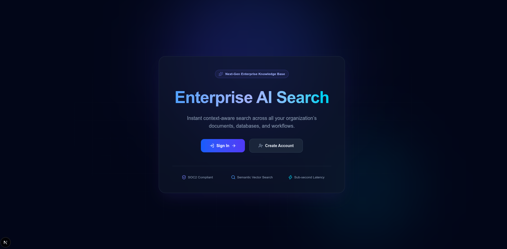
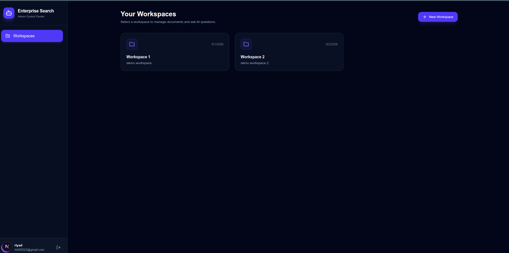
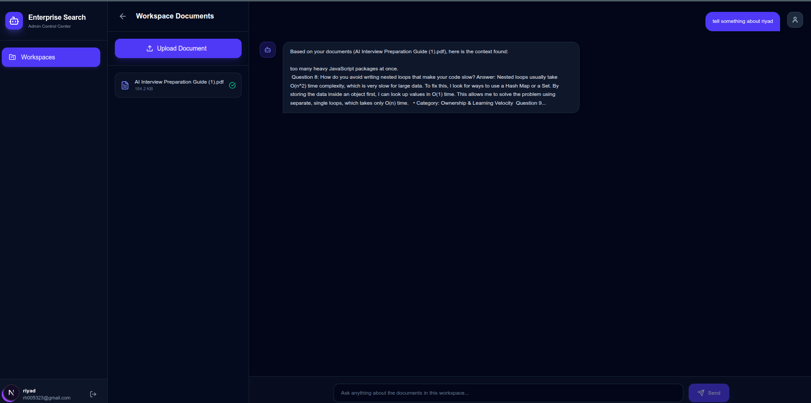
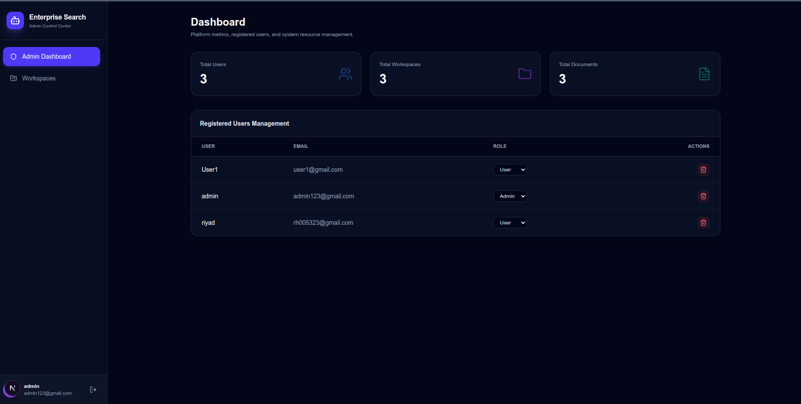
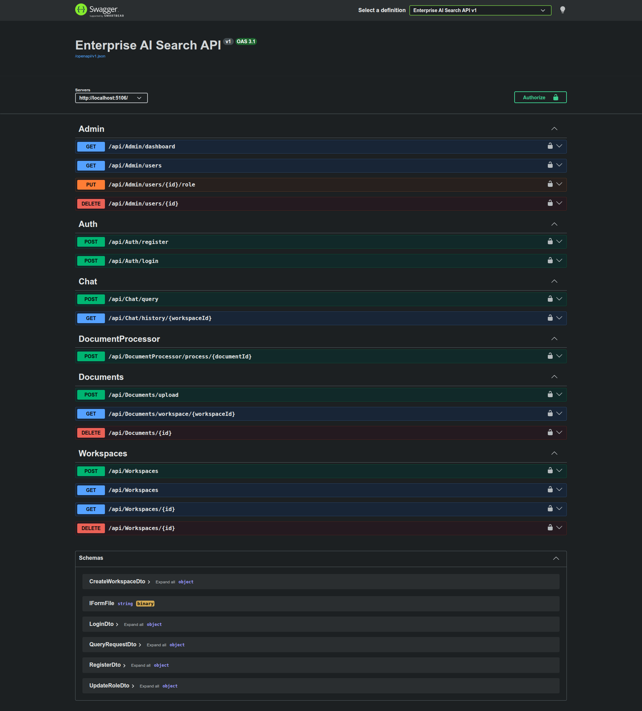

# Enterprise AI Search & RAG Platform

An Enterprise-grade Retrieval-Augmented Generation (RAG) platform designed to process, index, and query internal documents using AI. Built with a decoupled Architecture using **.NET 10 (Clean Architecture)** for the backend and **Next.js 16** for the frontend.

---

## 🚀 Key Features

* **Authentication & Authorization**: Secure User Registration and Login with JWT Bearer Authentication and Role-based Access Control (Admin / User).
* **Workspace Management**: Multi-tenant or user-isolated workspaces to organize documents separately.
* **Document Management**: File upload, PDF text extraction, and background document chunking.
* **Global Exception Handling**: Centralized exception management using .NET 10 `IExceptionHandler` returning standardized Problem Details.
* **Modern UI & Dashboard**: Clean UI built with Next.js App Router, Tailwind CSS, and Lucide Icons with a dark-themed responsive layout.
* **Admin Control Center**: Dedicated admin interfaces to monitor platform metrics, users, and overall systems.

---

## 📸 Screenshots

### Landing Page


### Workspaces
Users organize their documents into separate workspaces.



### Workspace Documents & AI Chat
Upload PDFs to a workspace and ask questions answered from the document context.



### Admin Dashboard
Platform metrics and registered user management (role changes, deletion).



### API Documentation (Swagger)
All REST endpoints: Admin, Auth, Chat, DocumentProcessor, Documents and Workspaces.



---

## 🏗️ System Architecture & Folder Structure

### 1. Backend (.NET 10 Clean Architecture)

```

src/
├── API/                   # Presentation Layer (Controllers, Middlewares, Exception Handlers)
│   ├── Controllers/       # AuthController, DocumentsController, WorkspacesController, etc.
│   └── Exceptions/        # CustomExceptionHandler (.NET 10 IExceptionHandler)
├── Application/           # Application Layer (DTOs, Interfaces, Business Logic)
├── Domain/                # Domain Layer (Core Entities, Value Objects)
├── Infrastructure/        # Infrastructure Layer (DbContext, Services, Document Processors)
└── Shared/                # Cross-cutting Concerns & Helpers
```
### 2. Frontend (Next.js 16 App Router)
```
src/
├── app/
│   ├── admin/             # Admin Panel & Management Pages
│   ├── dashboard/         # Workspaces and Dashboard Page
│   │   └── workspace/[id]/ # Individual Workspace & AI Document Viewer Page
│   └── (auth)/            # Authentication Pages
│       ├── login/
│       └── register/
├── components/            # Reusable UI Components (Sidebar, Layouts, Modals)
├── context/               # React Context Providers (AuthContext)
└── services/              # API Client (Axios Instance)
```
---

## 🛠️ Tech Stack

### Backend
* **Framework**: .NET 10 Web API
* **Architecture**: Clean Architecture (Onion Architecture)
* **Database**: PostgreSQL / Entity Framework Core (EF Core)
* **Authentication**: JWT (JSON Web Tokens)
* **PDF Processing**: UglyToad.PdfPig

### Frontend
* **Framework**: Next.js 16 (App Router) with React 19
* **Language**: TypeScript
* **Styling**: Tailwind CSS v4
* **Icons**: Lucide React
* **HTTP Client**: Axios

---

## ⚙️ Getting Started

### Prerequisites
* .NET 10 SDK
* Node.js (v20.9+ required by Next.js 16)
* PostgreSQL Database

---

### 1. Backend Setup

1. Navigate to the backend directory:
```
   cd enterprise-ai-search_backend/src/API
```

2. Configure appsettings.json or appsettings.Development.json with your database connection string and JWT key:
```
   {
     "ConnectionStrings": {
       "DefaultConnection": "Host=localhost;Port=5432;Database=enterprise_ai_search;Username=postgres;Password=your_password"
     },
     "Jwt": {
       "Secret": "YourSuperSecretKeyForJwtSigningHere_32BytesMin!",
       "Issuer": "EnterpriseAiSearchAPI",
       "Audience": "EnterpriseAiSearchClient",
       "ExpiryInHours": 12
     }
   }
```

3. Run EF Core Database Migrations:
```
   dotnet ef database update --project ../Infrastructure --startup-project . 
   ```

4. Start the backend server:
```
   dotnet run
   The API server will run at http://localhost:5106 (https://localhost:7037 with the https profile).
   Swagger UI: http://localhost:5106/swagger
```
---

### 2. Frontend Setup

1. Navigate to the frontend UI directory:
```
   cd enterprise-search-ui
```
2. Install dependencies:
```
   npm install
```

3. Set up environment variables in a .env.local file:
```
   NEXT_PUBLIC_API_BASE_URL=http://localhost:5106/api
```
4. Start the Next.js development server:
```
   npm run dev
   ```
   
   Open http://localhost:3000 in your browser.

---

## 🛡️ Error Handling & Reliability

* **Centralized API Error Handling**: All unhandled API exceptions are caught globally by CustomExceptionHandler.cs without polluting controllers with redundant try-catch blocks.
* **Document Status Resilience**: Document processing exceptions update status to "Failed" in the database to prevent hanging operations during PDF text extraction or chunking errors.

---

## 📄 License
This project is proprietary and confidential. Authorized access only....